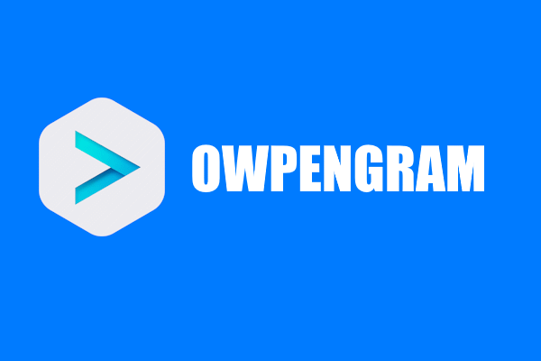

<p align="center">
  
</p>

# 🌐 OwpenGram for Web

**One familiar app. Any server you trust.**

OwpenGram for Web is the browser client of the OwpenGram project: a fast,
familiar messenger that talks to a server you run yourself. Nothing to install
for the people who use it — they open the address of your server and sign in.
Private by design, comfortable to use, and free from lock-in.

> 🌐 **Open it now** — the public OwpenGram server's web client is live at
> [web.owpengram.org](https://web.owpengram.org). Nothing to install.

> 🏠 **Or serve it yourself** — [owpengram-server](https://github.com/owpengram/owpengram-server)
> carries this client inside its binary and serves it on its own address. You
> can also host it separately and point it at a server.

> 🔗 Built on **MTProto API layer 229**, on top of Telegram Web K
> ([tweb](https://github.com/morethanwords/tweb)).

---

## 🚀 Try it without setting up anything

We run a **public OwpenGram server**, and its web client is open in any
browser: go to **[web.owpengram.org](https://web.owpengram.org)** and sign in. No
install, no key to paste, no Docker.

Want your own? Every OwpenGram server carries its own copy of this client, so
running [owpengram-server](https://github.com/owpengram/owpengram-server) gives
you the web version at your own address.

## ✨ Why you'll like it

- 🧩 **Nothing to install** — it is a web page; any modern browser will do.
- 🏠 **Bring your own server** — the page finds its server from where it was served, with no address to type.
- 🔑 **Key handled for you** — the embedded build reads the server's RSA key itself when it starts.
- 🧠 **Familiar & comfortable** — the experience you already know, no learning curve.
- 🔒 **Private** — talk on infrastructure you trust, away from the cloud.
- 🛡️ **Censorship-resistant** — your own server stays reachable when others are blocked.
- 🆓 **Open source** — read it, audit it, build it yourself.

## 🌐 One client, one server

Unlike the desktop and Android apps, the web client is not multi-server: a page
belongs to the server it talks to. Two ways to get it:

- **Embedded (the usual way)** — [owpengram-server](https://github.com/owpengram/owpengram-server)
  serves this client on its own address, the same port as the protocol
  (`http://your-server:2398/` by default). The page needs no configuration: the
  server is whoever served it, and the RSA key is read from that server on
  start. Nothing else to host.
- **Standalone** — build the client for one server and put it anywhere (your own
  web server, a CDN). The server address, and optionally its key, are baked into
  that build.

A page served over `https` can only reach a server that terminates TLS itself or
sits behind a reverse proxy; one served over `http` reaches a plaintext port.
That is the browser's rule, not ours.

Every OwpenGram server exposes its identity (name, description, icon) at
`/owpengram/server-info`, and the page uses its icon on the sign-in screen. Servers
that allow sign-up by email get an email field instead of a phone number.

## 🛠️ Build and run

Requirements: **Node** `^22.18.0 || >=24.11.0` and **pnpm**.

```bash
pnpm install
```

One launcher does the rest on every platform — `owpengram-web.bat` on Windows,
or `node scripts/owpengram-web.mjs`. It writes the server address into
`.env.local` (gitignored), so pointing a checkout at another server never shows
up as a local change.

```bash
node scripts/owpengram-web.mjs                        # ask, then run
node scripts/owpengram-web.mjs run --server 1.2.3.4:2398
node scripts/owpengram-web.mjs build --fetch-key      # standalone build
node scripts/owpengram-web.mjs build --fast           # skip tests and typecheck
node scripts/owpengram-web.mjs embed                  # build INTO owpengram-server
```

`run` starts the dev server at http://localhost:8080/ with live reload. `build`
makes the minified standalone version in `dist/`; copy it to your web server.

`embed` is the build the server carries. It needs no address and no key, and it
copies the result into your `owpengram-server` checkout — rebuild the server
afterwards to pick it up. (The result is large, so it is not committed; a server
built without it serves no web client.)

Plain upstream commands still work too: `pnpm start` runs Vite, and
`docker-compose up tweb.production -d` serves a build through nginx.

## 🧪 Debugging

There are classes bound to the global context: look through the code for the one
you need and get it by its name in the developer tools. Source maps are included
in the production build.

Query parameters, e.g. `http://localhost:8080/?debug=1`:

* **debug=1**: additional logging
* **noSharedWorker=1**: disable the Shared Worker
* **http=1**: force the HTTPS transport

You can see all the available svg icons by calling `showIconLibrary()` in the
browser's console. Local storage and IndexedDB snapshots are covered by the
[`snapshot-server`](snapshot-server/README.md) mini-app.

## 📦 Part of the OwpenGram project

- 🚀 [Server](https://github.com/owpengram/owpengram-server)
- 🤖 [Android client](https://github.com/owpengram/owpengram-android-client)
- 💻 [Desktop client](https://github.com/owpengram/owpengram-desktop-client)
- 🌐 [GitHub organization](https://github.com/owpengram)

## 💬 Community

- 📢 Channel: [@owpengram](https://t.me/owpengram)
- 💬 Chat: [Join the discussion](https://t.me/+sVB6Ymv70jEwNTAy)

## 📄 License

Based on [Telegram Web K](https://github.com/morethanwords/tweb) (Webogram,
patched and improved) — licensed under **GNU GPL v3** ([LICENSE](LICENSE)).

### Third-party
* [BigInteger.js](https://github.com/peterolson/BigInteger.js) ([Unlicense](https://github.com/peterolson/BigInteger.js/blob/master/LICENSE))
* [fflate](https://github.com/101arrowz/fflate) ([MIT License](https://github.com/101arrowz/fflate/blob/master/LICENSE))
* [cryptography](https://github.com/spalt08/cryptography) ([Apache License 2.0](https://github.com/spalt08/cryptography/blob/master/LICENSE))
* [emoji-data](https://github.com/iamcal/emoji-data) ([MIT License](https://github.com/iamcal/emoji-data/blob/master/LICENSE))
* [emoji-test-regex-pattern](https://github.com/mathiasbynens/emoji-test-regex-pattern) ([MIT License](https://github.com/mathiasbynens/emoji-test-regex-pattern/blob/main/LICENSE))
* [tlottie](https://github.com/dkaraush/tlottie) (MIT License)
* [fast-png](https://github.com/image-js/fast-png) ([MIT License](https://github.com/image-js/fast-png/blob/master/LICENSE))
* [opus-recorder](https://github.com/chris-rudmin/opus-recorder) ([BSD License](https://github.com/chris-rudmin/opus-recorder/blob/master/LICENSE.md))
* [Prism](https://github.com/PrismJS/prism) ([MIT License](https://github.com/PrismJS/prism/blob/master/LICENSE))
* [Solid](https://github.com/solidjs/solid) ([MIT License](https://github.com/solidjs/solid/blob/main/LICENSE))
* [TinyLD](https://github.com/komodojp/tinyld) ([MIT License](https://github.com/komodojp/tinyld/blob/develop/license))
* [libwebp.js](https://libwebpjs.appspot.com/)
* fastBlur
* [Mediabunny](https://github.com/Vanilagy/mediabunny) ([Mozilla Public License 2.0](https://github.com/Vanilagy/mediabunny/blob/main/LICENSE))
* [Temml](https://github.com/ronkok/Temml) ([MIT License](https://github.com/ronkok/Temml/blob/main/LICENSE))

---

⭐ If OwpenGram is useful to you, a star on GitHub helps a lot.
